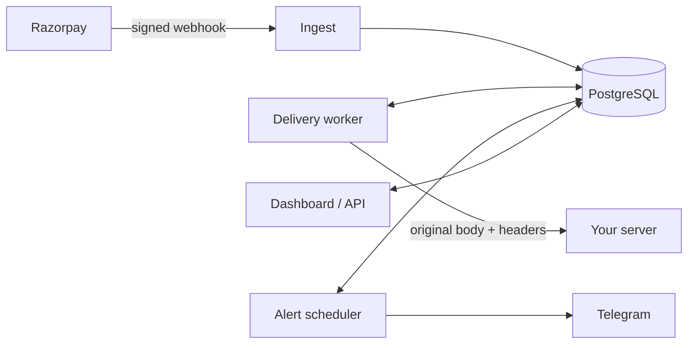

# Watchdog

**A webhook relay and monitor for Razorpay payment webhooks.** Watchdog verifies every event, stores it, forwards it to your server, retries when your server fails, and alerts you on Telegram when something goes wrong, including when webhooks stop arriving at all.

> **Status:** in progress, built in public. All code here is written by hand as a deliberate learning exercise; AI is used only to explain concepts, never to write the code. Progress is tracked in the [build log](#build-log) below.

---

## Why this exists

Payment webhooks fail quietly. Your server is mid-deploy, a webhook secret gets rotated, or a bug returns `500`, and the first you hear of it is a customer saying _"I paid, but my order never went through."_ Razorpay retries a failed webhook for 24 hours and then disables it, so a problem nobody notices can turn into hours of missed payments.

I ran the ordering platform for a live cloud kitchen, where a missed payment webhook means a customer has paid and the kitchen never sees the order. Watchdog is the tool I wanted then: something that sits between the payment gateway and your server, makes sure no event is lost, and tells you the moment the flow breaks.

## How it works

1. Create an endpoint in Watchdog and get a unique ingest URL.
2. Paste that URL into the Razorpay dashboard as your webhook URL, with the same webhook secret.
3. Watchdog checks the `X-Razorpay-Signature` header against the raw request bytes, stores the event exactly once (duplicates are recognised by `x-razorpay-event-id`), and replies `200` straight away.
4. It forwards the original bytes and headers to your server, so your existing signature check keeps working.
5. If your server fails, Watchdog retries with capped exponential backoff and jitter, and logs every attempt.
6. It alerts you on Telegram when deliveries keep failing, when signatures fail, or when no events arrive for longer than usual.
7. A dashboard shows every event and every delivery attempt, with a one-click replay.

Ingest, the delivery worker and the alert scheduler run in one Node.js process. All state lives in PostgreSQL, so a crash or restart never loses an event.

## Features

### MVP

- ✅ Create, update and disable endpoints through a JSON API
- [ ] Signature verification over the raw body, with a constant-time comparison
- [ ] Each Razorpay event stored once, however many times it is sent
- [ ] Forwarding to the destination with the original body and signature headers
- [ ] Retries with capped exponential backoff and jitter; dead deliveries after the last attempt
- [ ] A Postgres-backed job queue (`FOR UPDATE SKIP LOCKED`) that survives crashes
- [ ] Replay any event
- [ ] Telegram alerts for repeated failures, invalid signatures and silence, sent once when a problem starts and once when it ends
- [ ] Automated tests and a public deployment

### v1

- [ ] Sign-up and login with hashed passwords and server-side sessions
- [ ] Per-user data isolation
- [ ] Webhook secrets encrypted at rest (AES-256-GCM)
- [ ] Rate limiting on ingest URLs
- [ ] React dashboard: endpoints, events, delivery attempts, replay, alert rules

## Tech stack

| Layer         | Choice                                                           |
| ------------- | ---------------------------------------------------------------- |
| Runtime       | Node.js 24 with TypeScript (run natively via type stripping)     |
| Web framework | Express 5                                                        |
| Database      | PostgreSQL, accessed with `node-postgres` and plain SQL (no ORM) |
| Validation    | Zod                                                              |
| Crypto        | `node:crypto` (HMAC, scrypt, AES-256-GCM)                        |
| Tests         | `node:test`                                                      |
| Alerts        | Telegram Bot API                                                 |
| Dashboard     | React + Vite, served by Express                                  |
| Hosting       | Render (app) and Supabase (PostgreSQL)                           |

## Getting started

Setup instructions will arrive with the first runnable version. You will need Node.js 24.12 or newer, Git, and a PostgreSQL connection string.

## Design decisions

Written up as each one is built:

- Why a relay instead of a passive copy
- Why Watchdog replies to Razorpay before forwarding
- Why a Postgres table instead of Redis as the job queue
- Why invalid signatures get `401` instead of `200`
- Why server-side sessions instead of JWT

## Build log

| Week  | Focus                         | Status      |
| ----- | ----------------------------- | ----------- |
| 1     | Tools and JavaScript for Node | In progress |
| 2     | HTTP with no framework        |             |
| 3     | TypeScript and Express 5      |             |
| 4     | SQL and PostgreSQL            |             |
| 5     | Webhook ingest                |             |
| 6     | Delivery worker               |             |
| 7     | Alerts                        |             |
| 8     | Tests and deploy (MVP)        |             |
| 9     | Accounts and security         |             |
| 10–11 | Dashboard                     |             |
| 12    | Launch (v1)                   |             |

## Author

Built by **Madhav Vyas** · [LinkedIn](https://linkedin.com/in/madhav-vyas04) · [GitHub](https://github.com/MadhavVyas44)
